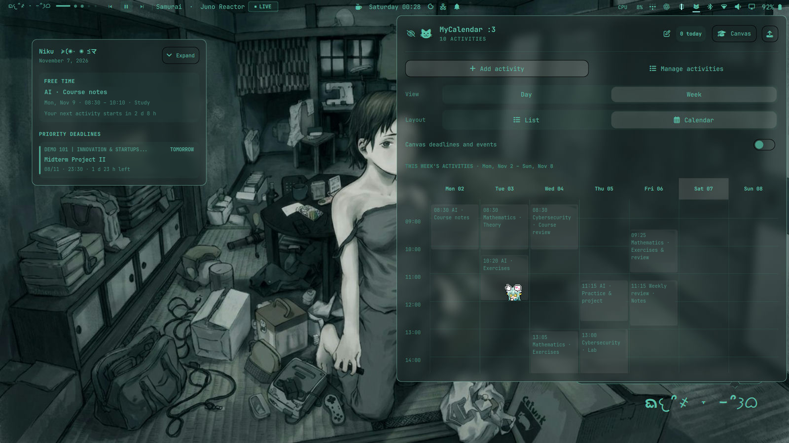
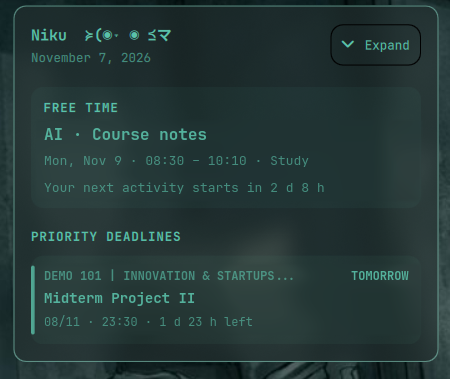
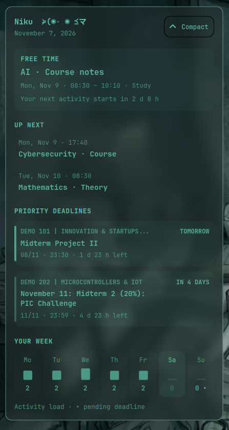
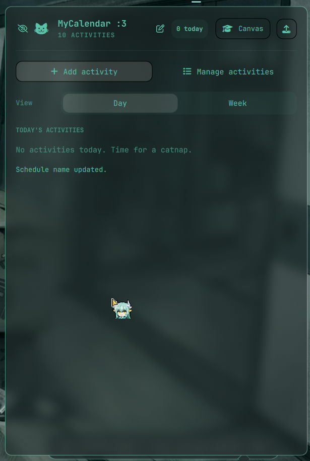
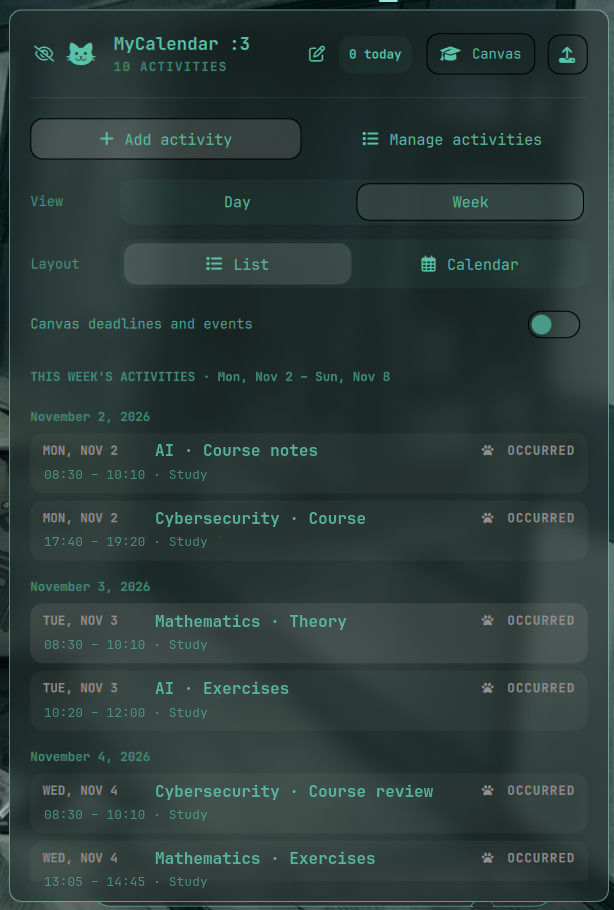
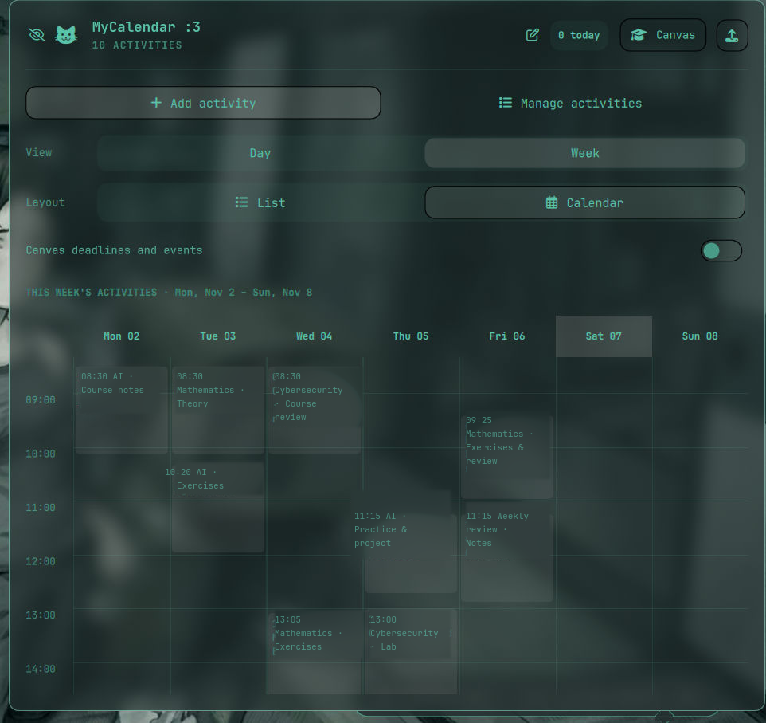

# Niku Calendar for Omarchy

An independent Omarchy bar plugin for creating and editing recurring activities,
opening class notes and links, importing CSV schedules, receiving reminders,
with daily/weekly calendar views, an optional Canvas academic panel, and an
interactive desktop widget.
It does not replace or modify the built-in clock or other calendar widgets.

> Keep your plans close and your paws ready. (=^･ω･^=)



<p align="center">
  
  
</p>

<p align="center">
  
  
  
</p>

<sub>Previews use fictional sample activities.</sub>

## Features

- Native Omarchy bar widget and themed popup.
- Complete English interface by default with optional Spanish localization.
- Editable schedule title that persists independently of its activities.
- Create, inspect, edit, and delete activities directly from the bar.
- Switch between a remembered daily view and a Monday-to-Sunday weekly view.
- Choose a weekly list or a compact hourly calendar, with overlapping activities
  arranged side by side, a current-time line, and clickable activity blocks.
- Labeled view controls; CSV import is tucked behind the upload icon.
- Distinct upcoming, `IN PROGRESS`, and `OCCURRED` activity states.
- A localized daily encouragement with a rotating cat kaomoji on busy days.
- Per-activity plain-text notes and multiple labeled HTTP(S) links, with an
  option to copy the links to every activity sharing the same title.
- Yazi file picker in an external terminal plus manual path input.
- Preview and row-level validation before an import is saved.
- One-time, weekly, biweekly, and monthly recurrence.
- Automatic accent highlight and `IN PROGRESS` label for the current activity.
- Muted styling and an `OCCURRED` label for completed occurrences.
- Native Omarchy notification ten minutes before every activity.
- Comma, semicolon, and tab delimiter detection.
- Spanish and English column aliases.
- UTF-8 and Latin-1 input support.
- Optional, read-only Canvas connection with a private offline cache.
- Canvas academic panel: assignments, announcements, courses, published grades,
  course materials, and optional deadlines/events in the weekly calendar.
- Desktop widget on workspace 1 of the primary monitor, disabled by default.
- Desktop activity progress, next-day activities, priority deadlines, clickable
  cards, a weekly workload strip, and remembered compact/expanded layouts.
- No third-party Python packages.

## Requirements

- Omarchy Quattro with the stock Omarchy shell.
- Python 3; the helper uses only the standard library.
- `yazi` and `xdg-terminal-exec` for the optional terminal file picker. A CSV
  path can still be entered manually when either command is unavailable.
- The built-in Omarchy notification service for ten-minute activity reminders.

The local schedule requires no elevated privileges, package manager, background
daemon, or network access. Canvas synchronization needs an Internet connection.

## Install

Install and enable the plugin with:

```bash
omarchy plugin add https://github.com/javihuh/niku-calendar-omarchy.git --enable
```

The widget defaults to the right section of the bar. Move it if desired:

```bash
omarchy bar move io.github.javihuh.schedule --section center
```

## Update

Update an installed copy to the latest version with one command:

```bash
omarchy plugin update io.github.javihuh.schedule --yes
```

Omarchy downloads the latest `main`, validates the plugin, and reloads it.
Your schedule, Canvas connection, and saved preferences are stored separately
and retained. See [what is new in v0.6.0](CHANGELOG.md).

## CSV Format

Save the file as UTF-8 CSV with this header:

```csv
title,weekday,monthday,start_time,end_time,recurrence,start_date,end_date,location,description
Mathematics,monday,,08:00,09:30,weekly,2026-09-21,2026-12-18,Room 3,Weekly class
Gym,wednesday,,18:00,19:30,weekly,2026-09-23,,Sports center,
Rent payment,,5,09:00,09:15,monthly,2026-10-05,,Home,Monthly reminder
Doctor appointment,,,11:00,12:00,once,2026-10-14,2026-10-14,Clinic,Checkup
```

An editable example is included at `examples/schedule.csv`.

### Columns

| Column | Required | Meaning |
| --- | --- | --- |
| `title` | Yes | Activity name |
| `weekday` | Weekly/biweekly | `monday` through `sunday`; inferred from `start_date` when empty |
| `monthday` | Monthly | `1` through `31` or `last`; inferred from `start_date` when empty |
| `start_time` | Yes | Start time in 24-hour `HH:MM` format |
| `end_time` | Yes | End time in 24-hour `HH:MM` format |
| `recurrence` | Yes | `once`, `weekly`, `biweekly`, or `monthly` |
| `start_date` | Yes | First valid date in `YYYY-MM-DD` format |
| `end_date` | No | Inclusive final date; empty means no end |
| `location` | No | Location |
| `description` | No | Notes |

Spanish column and recurrence aliases are also accepted for compatibility.

Monthly day `29`, `30`, or `31` activities are skipped in months that do not
contain that date. Use `last` to run an activity on every month's final day.

## Usage

1. Click the calendar icon in the Omarchy bar.
2. Choose **Add activity** to create an activity manually.
3. Use **Manage activities** to inspect, edit, or delete complete recurring series.
4. Switch between **Day** and **Week**. In Week, choose **List** or **Calendar**
   under Layout. The calendar covers Monday through Sunday with hours down the
   side, and scrolls vertically. Its panel grows only to 760 logical pixels wide
   (subject to theme scaling and available screen space), keeping the normal height.
   Both the period and layout are remembered.
5. Select an activity occurrence to open its notes, links, and editing actions.
6. Use the pencil beside the heading to rename the schedule.
7. Optionally enable the desktop widget with the small eye icon at the top left
   of the panel. It appears only when
   the primary monitor displays workspace 1 and hides on other workspaces.
    Click and drag the header to move it; its position is saved in
    `~/.local/state/omarchy/niku-desktop.json` and restored after a restart.

### Desktop summary

Use the eye icon in Niku's header to show the desktop widget. It offers:

- **In progress / Free time:** the current activity's progress and time left;
  when free, the next activity and its countdown, including tomorrow and later
  dates within the loaded schedule horizon.
- **Up next:** the following activities, with dates and times. Select any
  activity card to open its notes, links, and editing actions in Niku.
- **Priority deadlines:** unsubmitted work due today, overdue work, tomorrow's
  deadlines, then later work. Each card shows its course and deadline; select
  it to open Canvas. Planner completion is distinct from submitting work, and
  missing work is retained even if Canvas has assigned it a grade.
- **Your week:** Monday-to-Sunday activity counts and relative workload bars
  based on scheduled minutes. A dot marks a day with a pending Canvas deadline.
  Select a day to open the weekly calendar.
- **Compact / Expand:** switch between the current/next activity plus one
  priority deadline, or the full daily/weekly summary. The preference survives
  shell restarts. The header stays available when a tall summary needs scrolling.

Only the header drags the widget; clicking its content does not move it. The
widget stays within the screen bounds, keeps its saved position, follows the
theme and language, and unloads its visual content while hidden on another
workspace. Its clock also stops while hidden. Activity timestamps are prepared
once per data change; unchanged deadline cards are reused across clock ticks.
The weekly summary is recalculated only when its data or calendar day changes,
and is not calculated in compact mode.
Deadlines use the available Canvas snapshot (including the planner's recent
overdue window); an offline indicator identifies cached results.

You can also select the desktop layout from the terminal:

```bash
omarchy bar set io.github.javihuh.schedule desktopLayout Compact
omarchy bar set io.github.javihuh.schedule desktopLayout Expanded
```

### Canvas (optional)

Canvas is read-only and does not write to `schedule.json`. Open **Canvas**
in the header, enter the address of your Canvas site and paste your personal access
token into the hidden field, then select **Save and sync**. The setup form
appears automatically when there is no saved token; use the gear icon in that
panel to change the address or token later. Leaving the token field empty keeps
the existing token. Niku saves new tokens to
`~/.config/niku/canvas-token` (permissions `0600`) and configuration to
`~/.config/niku/canvas.json` (permissions `0600`). Existing token files
referenced by the configuration continue to work and are not modified unless
you enter a replacement token.

You can also configure Canvas manually by creating `~/.config/niku/canvas.json`:

```json
{
  "baseUrl": "https://canvas.example.edu",
  "tokenFile": "~/.config/niku/canvas-token"
}
```

Use your own Canvas URL; it must be an HTTPS origin (no `/api/v1` suffix).
Do not add the token to the JSON file or this repository. Niku checks Canvas
every 15 minutes while the bar is running; use the refresh button in the panel
to sync immediately. It reads active courses and planner assignments, ignores
completed deliveries, and shows deadlines in local time. Not all Canvas items
have due dates, so undated items are not shown. Canvas may also impose
restrictions on which courses and assignments your token can read.

The academic panel has these sections:

- **Assignments:** filter by course and pending, overdue, submitted, or all.
  Course assignment data includes undated work and actual submission state;
  marking something complete in the planner is not treated as submitting it.
- **Announcements:** recent course notices. Select a notice to expand its
  plain-text content, or use its external-link button to read it in Canvas.
- **Courses:** choose a course to see its assignments, or open it in Canvas.
- **Grades:** choose a course for published assignment grades and the current
  average supplied by Canvas. Missing grades are shown as unpublished; Niku
  does not invent or recompute the course's grading scheme.
- **Materials:** choose a course for module items, pages, links, and available
  files. Links open in the browser; Niku does not automatically download files.
- **Calendar:** return to Niku's weekly grid with the Canvas overlay enabled.
  Deadlines use diamond markers; timed events use blocks and all-day events
  have their own scrollable strip above the hours.

Academic resources load when requested, with independent private caches per
section, course, and account in `~/.cache/niku/academic/`. Saved data appears
first while stale data is refreshed in the background. Synchronization times,
offline results, and partial failures are shown in the panel. An inaccessible
course does not prevent the remaining courses from being listed. Use the
refresh button to request fresh data for the current section.

The cache is `~/.cache/niku/canvas.json` and is used offline; it contains
course and assignment names, dates and links, but never the token. Remove the
Canvas config file to disable the integration without affecting the schedule.
The widget can also be enabled from the terminal:

```bash
omarchy bar set io.github.javihuh.schedule desktopWidget On
```

Set the same option to `Off` to hide it.

The editor accepts dates as `YYYY-MM-DD` and times as 24-hour `HH:MM` values.
Weekly and biweekly activities use a weekday; monthly activities can use a day
from `1` through `31` or the final day of each month.

The editor always offers to save the link list only for the current day and
time or apply it to all activities with the same title. If no other day or time
has that title, both choices affect the same recurring series. Title matching
ignores capitalization. Applying to every match copies the links rather than
permanently synchronizing them, so one activity can later use a different URL.

The selected Day or Week view is remembered in the Omarchy bar configuration.
The large heading count always represents today's activities. An occurrence is
marked `IN PROGRESS` from its start time until, but not including, its end time;
at the end time it becomes `OCCURRED`. Past occurrences are regenerated from
the current recurring series rather than stored as immutable history.

### Language

The interface, validation messages, file picker, and reminders use English by
default. Switch the widget to Spanish with:

```bash
omarchy bar set io.github.javihuh.schedule language Español
```

Switch back with:

```bash
omarchy bar set io.github.javihuh.schedule language English
```

The setting applies live. Activity titles, notes, locations, link labels, and
other user-authored content are shown exactly as entered and are never
translated automatically.

### Importing CSV

1. Open the upload icon in the header, then select a `.csv` file or enter its path.
2. Choose **Preview CSV**.
3. Correct any reported row errors.
4. Choose **Import and replace activities**.

The local plugin state is authoritative after an import. Editing an activity
never modifies the source CSV. Importing another CSV atomically replaces all
activities, including manually added notes and links, while preserving the
custom schedule title. The panel displays this warning before import.

The plugin checks for upcoming activities every 30 seconds while the Omarchy
shell is running. A native notification containing the activity name, time, and
location is sent during the ten-minute window before it starts. Notifications
use normal urgency and respect Do Not Disturb.

Schedule snapshots now expand seven days ahead plus the current week, instead
of generating 120 days on every refresh. Identical snapshots reuse the current
model, and hidden activity lists are not instantiated. File changes trigger a
debounced refresh; periodic snapshot polling runs only every five minutes,
with a separate day-rollover check. Opening the panel and explicit refreshes
also update the snapshot. Visible views maintain their own clocks instead of
spawning a helper for each tick; reminder checks still run every 30 seconds.

See [desktop performance measurements](docs/performance.md) for the isolated
before/after CPU and memory results and their test conditions.

## Local Data

The normalized editable schedule is stored at:

```text
~/.local/state/omarchy/recurring-schedule/schedule.json
```

The source CSV is never modified. The stored schedule is created with user-only
permissions (`0600`) and protected by atomic writes and a revision check so
simultaneous panels cannot silently overwrite each other.

Version `0.3.0` migrates existing version 1 data automatically. Before the first
migration it preserves the original payload as `schedule.json.v1.bak` in the
same state directory.

Sent reminder occurrences are tracked in
`~/.local/state/omarchy/recurring-schedule/reminders.json` so shell reloads and
multiple monitors do not create duplicate notifications.

No local schedule content is transmitted by the plugin. Canvas requests use
only the account token and are read-only. Saved links are validated as HTTP(S)
URLs and open in the default browser only after an explicit click.

## Remove

Remove the plugin with:

```bash
omarchy plugin remove io.github.javihuh.schedule
```

Omarchy intentionally leaves imported schedule data in place. To remove that
data as well, run:

```bash
rm -r -- "$HOME/.local/state/omarchy/recurring-schedule"
```

The original CSV is never modified or removed.

## Development

Validate the manifest and run the tests:

```bash
omarchy plugin validate .
/usr/lib/qt6/bin/qmltestrunner -platform offscreen -input tests
python3 -m unittest discover -s tests -v
```

The helper can also be exercised directly:

```bash
python3 schedule.py preview examples/schedule.csv
python3 schedule.py import examples/schedule.csv
python3 schedule.py status
python3 schedule.py remind
python3 canvas.py
python3 canvas.py --academic courses
python3 canvas.py --academic assignments --course 123
python3 canvas.py --academic grades --course 123 --cached
```

Backend messages default to English. Pass `--language es` before the command
to exercise Spanish output, for example:

```bash
python3 schedule.py --language es preview examples/schedule.csv
```

Mutation commands (`rename-schedule`, `create-activity`, `update-activity`, and
`delete-activity`) accept one JSON object on standard input. They use the saved
revision to reject stale edits and are primarily consumed by the QML panel.

The `status` helper defaults to a seven-day horizon; pass `--days 120` explicitly
when a longer expansion is needed. Academic helper tests use mocked responses
and temporary configuration/cache directories, never real tokens or network calls.

Planned import adapters include spreadsheets, iCalendar, PDF, images, and OCR.
CSV is intentionally the first format because it is deterministic and can be
fully validated before changing saved data.

## License

MIT, copyright 2026 javihuh.

## Support

If Niku Calendar is useful to you, you can support its development on ☕︎
[Ko-fi](https://ko-fi.com/javihuh) and check it out my art ฅ^•ﻌ•^ฅ
